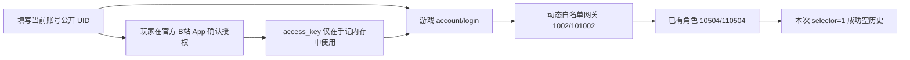
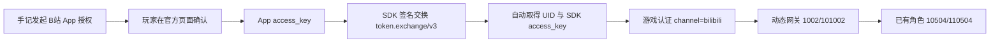

# Bilibili 渠道：面向玩家的授权入口研究

> 历史研究归档（2026-10-23～24）。文内“尚未接入”“待验收”和测试版本号描述的是当时阶段，不代表当前发布状态。B 服与 TapTap App 入口已纳入 Android 0.3.6，真机 TapTap 授权修复已合入 `debug`；授权后仍需手动切回，通知返回方案未保留。当前流程以[渠道登录说明](../gacha-channel-login.md)、[用户指南](../gacha-user-guide.md)和源码为准。

核对日期：2026-10-23。当前优先级由用户明确调整为：**先证明普通玩家能在手记中稳定授权，再测试凭据进入游戏与历史查询。** 原版 B 服 SDK 会话的单次游戏认证已成功，不能据此认定手记已具备登录能力。

**20:21 最新实测：无需填写 UID。独立验证器通过官方 B 站 App 确认授权，使用《星落》客户端接入配置复现 SDK 请求签名，交换自动返回 UID 和 SDK 令牌；使用交换后的令牌通过游戏认证、已有角色态及 selector=1 成功空历史。取消后重新授权、原版游戏进程关闭后的完整链路复核均通过。18:45 的手填 UID 路径保留作备用。正式客户端、Windows 独立授权、长期稳定性和非空历史仍待完成。**

## 授权路径的验收条件

目标流程是玩家从手记发起，进入可识别的官方授权界面，亲自完成登录与确认，再回到手记。正常使用不能要求 root、ADB、读取游戏私有目录、附加游戏进程或手抄令牌。实验安装 APK 可以使用 ADB，不能将其作为最终用户依赖。

必须分别确认三件事：授权入口能正常使用、返回的凭据确实适用于《星落》B 服、取消/重新授权/失效后的恢复流程可重复。Windows 和 Android 分别验收；Android 上存在入口不代表 Windows 可直接内嵌同一套 SDK。

## 已核对的官方资料

旧 SDK 文档地址目前返回营销页面。已通过当前官方文档中心及其公开文档接口读取正文，更新此前“未读到 SDK 文档正文”的阶段状态。

- [SDK 接入指南](https://open.biligame.com/docs/#/view/5e29ad10ba1211ec836ad69817578ac6/8d5ae690bfc511ec836ad69817578ac6)：常规游戏 SDK 初始化需要平台分配的接入参数。文档区分客户端通信签名用的 `app_key` 和服务端的 `secret_key`；不能把二者混称，也不能把 SDK 的公开下载视为已获得《星落》的接入资格。
- [PC SDK 文档](https://open.biligame.com/docs/#/view/5e29ad10ba1211ec836ad69817578ac6/bb199b70c1e211ecb9fafea22d17cf6a)：初始化同样要求游戏、商户、服务器和客户端接入参数；登录成功有账号及令牌回调，返回身份受配置影响。
- [官方 PC 登录页面](https://sdk.biligame.com/login)：公开页面脚本依赖宿主传入游戏及接入配置，并向原生宿主回调。单纯嵌入网址尚不能形成手记可用的独立授权方案。

这些资料支持“标准 SDK 有接入条件”，尚不足以证明所有第三方授权路线均不存在。早期实验没有读取或使用原版 SDK 密钥；后续经用户明确授权，使用《星落》自身客户端接入参数完成了独立 SDK 签名交换，见 20:15–20:21 记录。没有套用其他游戏参数。

## 候选路径与当前判断

| 路径 | 证据 | 当前状态 |
|---|---|---|
| 手记直接接入游戏 SDK | 官方 Android/PC 文档 | 需要解决合法宿主接入参数与资格；未形成普通玩家可用方案 |
| Android 调起 B 站 App 显式授权 | 原版游戏 SDK 保留调用分支；当前官方 B 站 App 有导出的 SSOActivity | 手机/MuMu 授权回调成功；MuMu 加入公开 UID 后已通过游戏认证、已有角色态和一次空历史查询。仍需处理开屏任务遮挡、失效与切换账号 |
| 官方 App 授权 + 独立 SDK 签名交换 | 原版初始化、公共参数、签名及交换链路；20:15–20:21 实测 | MuMu 无需手填 UID，自动取得 SDK 身份和令牌并成功查询一次空历史；不需要原版游戏进程或完整 SDK 运行时 |
| Windows 嵌入官方 PC 登录页 | 官方网页及 PC SDK 文档 | 页面仍依赖宿主配置；裸页面不能作为已解决路径 |
| 原版游戏向手记显式导出授权 | 原版清单与公开资料 | 未发现可验证的公开回流/导出合同；不调用未导出的私有 Activity |
| 门户绑定、网页导出或其他开放入口 | 当前公开检索 | 尚未找到《星落》B 服可直接复用的入口；继续保留为研究候选 |

Android 候选的静态链路是：调用方以自己的真实包名启动 B 站 `SSOActivity`，B 站读取该包的名称/图标展示给玩家，玩家同意后通过 Activity 结果返回 `access_key`。原版游戏 SDK 后面还有自己的 OAuth 处理及通用签名层。

**不能仅凭字段名认定 App `access_key` 与 SDK `access_token` 在范围、寿命或权限上等价。** 早期只有回调形状时不能判定游戏可用；18:37–18:45 后续实测已确认前者在当前账号/版本可直接用于游戏认证、角色态和历史查询。没有混用此前原版 SDK token，也不将本次兼容性成功称为长期稳定的官方第三方接入合同。

## 独立 Android 验证器

实验包名 `cn.starfall.gacha.authprobe`，界面名称“抽卡手记·授权验证”。源码、构建产物和临时签名均位于专用工作区 `E:/AI-Agent/OpenAI-Codex/bilibili-channel-research/authorization/probe/`，不加入产品仓库。

- 使用自己的包名、应用名称及实验签名，不伪装成原版游戏。
- 未声明网络或存储权限，无第三方 SDK；不读取游戏数据，不连接游戏或账号服务器。
- 玩家亲自点击按钮并在 B 站确认；验证器只显示结果状态及字段是否存在，不显示、保存或发送凭据。
- 已用现有工具编译、签名验证通过，清单权限检查为空；已安装并打开 MuMu 中的说明页。

2026-10-23 约 16:15，用户报告模拟器中的 B 站无法启动。系统退出记录确认 `tv.danmaku.bili` 连续出现 `APP CRASH(EXCEPTION)`；脱敏代码栈包含 `CoroutinesInternalError`、`UninitializedPropertyAccessException` 以及 B 站 crashreport 初始化任务。尚未确定完整根因，不将其推断为授权权限拒绝或 SDK 不支持。验证器仅收到 `RESULT_NOT_ACCEPTED`，未取得可用授权结果。

MuMu 中的 B 站 App 启动问题未解决；后续已转到用户手机验证，无需安装游戏或开启 root。不通过修改 B 站、伪造包名或访问私有数据绕过模拟器问题。

用户同意自行在手机安装 APK 并回传报告，无法将手机直接连接给研究环境。为此验证器升级为 `0.0.2-diagnostics`：记录系统/B 站版本、组件可访问状态、调用/回流事件、耗时、结果码及固定字段类型，提供手动返回标记和一键复制。最近八次尝试的脱敏报告保存在验证器私有目录，凭据真实值不保存；不包含 UID、设备唯一标识或任意返回字段内容。脱敏逻辑已用虚构令牌、UID 和未知类型进行测试，确认报告不会将这些值或任意字段名带出。

### 用户手机回传：授权字段已取得，游戏适用性尚未测试

2026-10-23 **16:28:07–16:28:15 +08:00**，用户在 Android 14（API 34）的 vivo V2162A 上使用 B 站 **9.14.0（9140400）** 测试。回传的脱敏报告显示：

- 授权组件存在、已启用、exported=true，无组件权限要求。
- `result_code=-1`（RESULT_OK），有返回 Intent，耗时 **8242 ms**。
- 仅白名单中的 `access_key` 为非空字符串；`uid/mid/game_open_id/access_token/code` 等字段均缺失。
- 记录到验证器离开和恢复事件；之后用户点击了手动返回标记。该标记本身不能证明 Android 自动回流失败，需结合用户观察。

这确认普通独立包可以取得显式 App 授权回调；不代表已取得《星落》SDK 会话，也不代表长期稳定性或 Windows 支持。`0.0.2` 会丢弃真实值，没有执行凭据有效性检查或游戏请求。

进一步静态核对原版 SDK：`OAuthLoginActivity.onActivityResult` 读取 `access_key` 后交给 OAuth presenter，后者调用 `/api/external/token.exchange/v3` 并处理 `UserInfoModel`；SDK 另有通用参数/签名拦截器。这证明原版 SDK 有交换步骤，**不证明游戏服务必然只接受交换后的令牌**。此前将它视为第三方工具必经步骤的推断应撤回，后续直接认证实测见下节。离线证据为 `oauth-exchange-trace.json`，未请求交换接口，未提取或使用接入密钥。

后续实际验收由验证器在本机内存中使用授权结果，仅回传脱敏状态。研究者无需收到原始凭据；UID 来自当前登录账号的官方公开资料，不使用猜测值。

### MuMu 恢复后：已执行本机凭据验收

用户重新安装并登录官方 B 站 **9.16.1（9161100）**，明确授权研究者直接操作 MuMu 和授权确认，无需逐次请用户代点。本轮使用普通 ADB 通道，没有 root、读取游戏私有目录或附加游戏进程。

- `0.0.2` 在 MuMu 上正常显示官方授权页，请求方名称为验证器；确认后回流并取得非空 App `access_key`。
- 专用工作区新增隔离的 `probe-online/`，升级为 `0.0.3-local-verification`，仅新增 INTERNET 权限。令牌只在授权结果和短时工作线程内使用，不写文件、日志、剪贴板或研究者报告。
- 只允许两个固定 HTTPS 路径：B 站本账号信息、星落游戏认证。禁止跳转、替代主机/端口、重试及网关连接；仅在身份接口成功返回明确账号 ID 后才允许条件性的游戏认证。端点白名单及既有凭据脱敏测试通过，编译/签名/安装/运行检查通过。
- 账号信息路径来自官方 B 站 APK 的 Retrofit 注解：`GET /x/v2/account/myinfo`，显式参数为 `access_key`；请求拦截器另补参数和签名。没有采用第三方整理中的共享客户端密钥或签名常量。
- **2026-10-23 16:44:17 +08:00**，新的正常 App 授权结果在 MuMu 内存中用于一次不带 SDK/客户端签名的账号信息 GET。返回 **HTTP 200、业务 code=-400、无账号 ID**。由于前置身份未通过，**没有发送游戏认证请求，没有连接网关**。
- 后续定向静态核对确认，该接口继承 `AuthInterceptor`，会补充 `appkey/platform/mobi_app/build` 等参数，并经 `signQuery` 使用应用签名处理。没有读取、提取或使用其具体密钥值。`-400` 本身不能定位某一个缺失字段，也不能证明令牌失效；结论仅为这次独立请求形式未被接受。
- 取消测试中，点击官方授权页返回箭头后正常回到验证器，显示 `CANCELLED_OR_REMOTE_EXIT`，没有新增在线验收。
- 一次重复进入时，B 站开屏广告及主页任务覆盖了尚在等待的 SSO 页面。任务栈仍保留授权 Activity 及结果接收关系；切回验证器任务后可见原授权页。没有清数据、强停 B 站或修改其启动策略。该现象说明入口稳定性仍需处理前台任务切换，不能仅凭成功回调就称为完整稳定方案。

16:44 阶段的脱敏结果保存在研究目录 `authorization/mumu-online-result.json`。当时只证明 App 授权与取消交互可用，尚未解决游戏身份输入；没有复用原版 SDK token 掩盖缺口。该阶段限制随后由公开 UID 的直接路径解除，见下节。

上述是 16:44 时的阶段状态；后续无需该账号信息接口或 SDK 交换的路线已经实测成立：

### 18:37–18:45：公开 UID + App 授权直接进入游戏

补充读取 [官方游戏服务端文档](https://open.biligame.com/docs/#/view/5e29ad10ba1211ec836ad69817578ac6/ec146f50c11c11ec836ad69817578ac6)，确认 SDK 会话验证中的 UID 为 B 站用户 UID。文档将游戏 SDK 回调令牌称作 `access_key/access_token`，这属于该 SDK 语境，不能单凭该命名认定主 App 令牌等价。

研究者在官方 B 站当前登录账号的“空间 → 详情”核对公开 UID，再填入验证器的临时输入框；授权页显示同一账号与验证器真实名称，正常确认。UID 和令牌都不写报告，从验证器内存直接用于官方认证/网关请求，没有传给研究者或主机探针。

| 时间（+08:00） | 实验 | 结果 |
|---|---|---|
| 18:37:53 | `0.0.4`：公开 UID + 新正常 App 授权结果，直接游戏 `/account/login` | HTTP 200，`retCode=0`；未连网关 |
| 18:38:53 | 同一自有 UID + 明显无效字符串，单次负对照 | HTTP 200，`retCode=-500`；未连网关 |
| 18:39:40 | 同一自有 UID + 32 字符全零值，排除仅格式差异的负对照 | HTTP 200，`retCode=-101`；未连网关 |
| 18:43:03 | `0.0.5`：新 App 授权，认证后连动态白名单网关，单次 `1002/101002` | 认证 0，进入 0，`actorExist=true`，随后断开 |
| 18:45:22 | `0.0.6`：再次正常授权，认证和角色态后单次 `10504/110504` | 进入 0，`actorExist=true`，selector=1 返回 0、记录 0 条，随后断开 |

角色态与查询使用 `channel=bilibili`、`platform=1`、原 App token、已核对的公开 UID，以及**验证器自己随机生成的 UUID**。复用现有 `Wire` 编解码，只改实验副本的包名；未读取原版游戏设备字段。实验时原版游戏进程没有运行，未创建角色、操作教程或抽卡。

负对照本身不能还原服务器验签实现；与正常令牌、角色态及只读查询的成功一起，支持“本账号的正常 App 授权结果可以直接使用”，无需在手记里自行实现 SDK 交换。空历史是业务请求成功，**不等于已验证非空记录内容和实际抽数**。

全部中间材料在研究目录：`probe-direct-auth/`、`probe-role-session/`、`probe-history/`，聚合脱敏证据 `accepted-app-credential-chain.json`。产品可据此优先考虑 Android 官方 App 授权 + 一次公开 UID 输入；该 UID 尚未自动取得，不能写成完全自动识别账号。

可供手机独立复核的研究 APK 位于 `authorization/phone-test-v0.0.6/`，含测试说明、SHA256 和可安装包；只查 selector=1，一次授权最多各发送一次认证、进入和历史请求。端点策略、凭据脱敏测试与签名验证通过，最终交付包已在 MuMu 安装并检查成功空历史摘要。没有把研究 APK 当作正式产品发行包。

### 19:06–19:17：保留手填，尝试自动 UID（尚未成功）

用户明确要求“首次填写先保留，尝试看看能不能自动获取”。研究版本增加独立自动分支，原手填分支的 `OnlineVerifier/Wire` 业务实现保持原样。每次自动实验前均确认 UID 输入框为空；只使用新正常 App 授权结果，不以已知 UID 作为隐藏输入。

1. 只读复制当前官方 B 站 9.16.1 的公开 APK；定向检查 `classes25.dex` 的 `SSOActivity`，确认普通确认回调只调用一次 `putExtra(access_key)`，未发现该入口附带 UID 的参数开关。没有读取 B 站私有目录或访问未导出组件。
2. `0.0.7` 用授权结果分别请求两个固定官方账号接口。`/x/web-interface/nav` 返回 HTTP 200、code=-101；`/x/space/myinfo` 返回 HTTP 200、code=-663。均没有取得 UID，没有调用游戏认证或网关。这里只记录本次请求未成功，不将单次错误解释成所有调用方式都不支持。
3. `0.0.8` 不重复前两条接口，仅对游戏 `/account/login` **省略 openId**，携带正常 token/channel/platform 等字段。HTTP 200、retCode=0，但 data 只有 `addresses` 与 `timezoneOffset`，没有 UID。此阶段没有打开网关；探针顶层旧 `game_auth_attempted` 标志当时指“取得 UID 后的配对验收”，token-only 请求实际已执行，以该子阶段结果为准，后续版本已改正该标志含义。
4. `0.0.9` 在 token-only 认证成功后，向白名单网关发送一次**不含 openId 字段**的 EnterGameReq，使用验证器随机 UUID。101002 返回码为 0，但 **actorExist=false**，没有可恢复的数字型 ActorInfo.openId。立即断开，没有创建角色、查历史或重试。此前同一正常账号提供公开 UID 时已有角色并成功查询，因此该结果不能解释为用户账号没有角色。

ActorInfo schema 明确 `openId=1`、`uin=2`；自动恢复逻辑只考虑认证成功且已有角色中的 `openId`，不拿角色 UIN 冒充 B 站 UID。独立测试覆盖失败响应、无角色、非法身份、UID 大整数精度以及两个命名空间的区分；端点与脱敏检查通过。真实凭据和 UID 不入报告。

该阶段结论是尚未取得自动 UID，因此保留首次填写公开 UID/空间链接；**这已被后续 SDK 签名交换成功更新**。自动失败时仍不能把身份未解析状态展示成“新号无角色”，也不能自动创建角色。该阶段产物在 `authorization/probe-auto-uid/`，脱敏记录为 `auto-uid-research-results.json`；手填验证包为 `phone-test-v0.0.6/`。

### 19:27：按原版游戏现场复核授权与 SDK 后段

用户要求对照 MuMu 中原版游戏的“bilibili 授权登录”。本轮在原版登录弹窗点击该按钮，看到官方 B 站账号授权页，请求方显示“星落”；按用户既有授权点击确认，返回原版游戏的 START 启动页。没有点击 START、操作教程或抽卡。本次 UI 观察仅确认授权后回到游戏，不能单独证明角色进入或某个后台请求的实际响应。

定向静态追踪补充如下，证据在专用工作区 `authorization/game-sso-tail-trace.json`，只保存调用关系、字段名和白名单常量，不保存配置值或凭据：

- `OAuthLoginActivity.a` 包含与独立验证器相同的显式 `SSOActivity` / `tv.danmaku.bili.action.AUTHORIZE` 分支；`onActivityResult` 读取 `access_key` 后交给 OAuth presenter。
- `OAuthLoginModel.execute` 明确使用 `/api/external/token.exchange/v3`；其回调 `mvp/a$a.a` 把响应反序列化为 `UserInfoModel`，处理成功状态并传递用户信息。
- presenter 的用户信息检查方法读取 `UserInfoModel.uid` 和 `UserInfoModel.access_key`，两者均为非空才通过相应检查。此处是 SDK 模型字段名，不应与最终 Unity 的 `access_token` 回调名称混为同一结构。

因此，“模拟游戏的授权流程”需要拆开验证：前半段官方 App 授权已经由独立包复现；原版后半段有明确的交换响应到 UID 的代码链路，仍应作为自动身份研究的重点。此前几个独立账号接口失败不能据此判定这条路线不可复用。标准 SDK 配置和签名层的存在也不等于已实测证明每一种独立调用都失败；本轮没有发送交换请求，更没有验证它可由手记独立使用。

后续研究应优先核对该交换路径及合法接入条件。首次填写 UID 继续保留为已验证的备用入口，不把它提前定为最终必需交互，也不将原版游戏成功登录等同于手记已经能够自动取得 UID。

### 续查：SDK 交换参数、初始化配置与最小在线实验

用户要求沿原版 SDK 交换方向继续深入，研究仍为隔离的临时实验，没有新增正式产品功能。

#### 静态调用链已进一步定位

1. 原版 `OAuthLoginActivity.onActivityResult` 的旧 App 授权分支读取 `access_key`，以第二参数 `"0"` 调用 presenter；对应 `key_type=0`。另一分支的参数为 `"2"`，不能混用。
2. presenter 的构造方法 `mvp/a.b` 向请求 map 写入 `access_key`、`key_type`、`version="3"`；非 `key_type=2` 时对应 `acct_exchange_type="10"`，另有激活和设备信息处理。
3. `OAuthLoginModel.execute` 指向 `/api/external/token.exchange/v3`。`GSCBaseConfig` 的 HTTPS 交换线路列表依次包含 `line3-sdk-center-login-sh.biligame.net`、`line3-sdkcenter-login.bilibiligame.net`、`p.biligame.com`；这来自原版静态配置，不能冒充实时网络捕获。
4. `ParamsSignInterceptors.setParams` 会合并公共参数、当前时间戳、`domain` 和请求参数，调用 `CommonParamUtils.generateSign`，并通过规则层补充请求头。部分路径另有设备指纹处理。
5. `generateSign` 在排序和拼接后读取 `UpDataModel.appKey`，交给 `MD5.sign`。这一定位阶段尚未提取密钥值；随后在用户明确授权后复现了真实 SDK 请求签名，见下文。
6. `UpDataModel.init(Context, String, String, String, String)` 的寄存器元数据为 14 个寄存器、5 个参数字；`merchant_id ← v10`、`app_id/game_id ← v11`、`server_id ← v12`、`appKey ← v13`。这直接证明正常初始化的签名配置由调用方传入；不是 App 授权结果中的隐藏 UID。写入索引还发现独立 free 模块可写 `appKey`，未将该模块当作普通 OAuth 分支或复用其配置。

官方[SDK 集成指南](https://open.biligame.com/docs/#/view/5e29ad10ba1211ec836ad69817578ac6/8d5ae690bfc511ec836ad69817578ac6)称 `app_key` 为客户端密钥，明确与服务端密钥区分。客户端 SDK 请求签名、APK/证书签名及渠道服务端私钥也应分别讨论，不能仅因都含“签名/密钥”字样而混同。

只读检查当前自有游戏 PID 的现有日志，未提取到已知交换路由或相关请求字段名。没有输出或保存原始日志；日志没有这些信息不代表实际请求不存在。未重新附加进程、开启 root、重启模拟器、截获 TLS 凭据或修改游戏。

#### 最小请求结果及其边界

专用工作区新增 `authorization/probe-exchange/`，真实包名和开发签名沿用验证器，仅有 INTERNET 权限。两次均在 UID 输入框为空时重新走官方 App 授权，令牌只留在探针内存。

| 本地时间 | 实验 | 结果 |
|---|---|---|
| 19:36:23 | `0.0.10`：单次 HTTPS 表单 POST，携带 App token、key_type=0、version=3、acct_exchange_type=10、timestamp；不带 SDK 接入配置或签名 | HTTP 200、JSON；未取得 UID，没有游戏认证/网关请求。旧诊断器未记录业务码字段的类型，不能从 null 码归因 |
| 19:38:47 | `0.0.11`：改进字符串业务码解析与字段类型诊断，重新授权后复核相同请求 | HTTP 200、JSON 顶层仅 1 个字段，白名单 code/message/uid/access_key/data 等均缺失或为 null；没有已认证 UID，没有游戏认证/网关请求 |
| 随后 | 主线路不带任何账号凭据的同类对照；再补原拦截器中已确认的 domain 参数 | 两次均为 HTTP 200，JSON 只有 requestId 字符串；没有 SDK 业务码或身份 |
| 随后 | 第二条已知线路，带 domain、不带任何账号凭据的同类对照 | HTTP 200，JSON 只有 requestId 字符串 |
| 随后 | p.biligame.com 已知备用线路，无账号凭据 | TLS 握手超时，没有取得 HTTP 响应；不记作认证失败 |

`0.0.10` 的诊断缺口通过先失败后通过的字符串码测试修正；`0.0.11` 表明本次响应本身没有已知业务码，不能反过来声称原响应一定只是“字符串码未解析”。带令牌响应没有保存原始未知字段名，不能仅凭无令牌对照就宣称它也必然只有 requestId。

这些是**不完整、无签名的最小请求**，缺少 merchant/app/game/server 配置、其他动态公共参数和签名请求头，不能称为完整复现原版 SDK，更不能据此声称有效 App token 被拒绝、签名校验确已失败或所有独立 SDK 调用不可行。没有并发或自动重试，没有使用其他游戏的开发者参数。

探针的精确端点限制、表单编码、响应值脱敏、仅成功响应可提取 UID、SDK 字符串业务码等测试通过；APK 编译及 v2/v3 签名检查通过，并已在 MuMu 安装运行。可用手填路径的 `OnlineVerifier/Wire` 沿用原实现。脱敏聚合记录为 `authorization/sdk-exchange-research-results.json`；完整静态调用证据为 `exchange-operands.json`、`sdk-config-writes.json`、`sdk-init-signatures.json`。

#### 下一步边界

原任务要求“不得伪造官方签名”，研究者就客户端 SDK 请求签名的范围作了澄清。用户随后明确允许按实现目标继续；本次实际只需复现正常客户端协议签名，验证器继续使用自己的包名、名称和 APK 签名。澄清前没有提取客户端接入密钥值；澄清后才使用《星落》自身客户端配置进行下述实验，不涉及渠道服务端私钥或其他游戏凭据。

### 20:15–20:21：自动 UID 与完整 SDK 凭据链路成功

#### 客户端配置来源与可复现边界

定向检查原版 `UnityPlayerActivity` 构造器中的配置赋值及 `onCreate` 调用，解析到 `BSGameSdkCenter.init` 的五个字符串参数。再跟踪其调用 `GSCPubCommon.init` 的实参，确认第 0/1/2/3 个参数分别用于商户、应用、区服与客户端密钥；应用参数同时写入 `app_id/game_id`。配置只生成到专用工作区 `authorization/probe-exchange-signed/SdkClientConfig.java`，不写入仓库、诊断报告或工具输出。来源证据为 `sdk-client-config-provenance.json`，准备脚本 `prepare_sdk_client_config.py` 可重现映射。

同时核对 SDK 字段默认值和具体 HTTP 实现：SDK 版本为 5.9.0，SDK 平台字段为 3，游戏认证平台字段仍为 1；两者不可混用。原版使用表单 POST 和 `Mozilla/5.0 BSGameSDK`。独立实现按 SDK 规则排序字段、拼接参与签名的值并以客户端配置生成 MD5 请求签名，再编码表单；没有传输客户端密钥本身。

实验携带已确认的授权分支参数、商户/应用/区服、SDK/平台参数、domain 和时间戳。没有嵌入完整原版 SDK 运行时，没有生成 native CustomRules 请求头，也没有复制原版设备指纹或设备 ID。实际成功说明本次所用客户端请求形式已足够，不代表所有未发送字段在其他版本均无作用。

#### 真实验收结果

| 时间（+08:00） | 版本和凭据路径 | 结果 |
|---|---|---|
| 20:15:35 | `0.0.12`：App 授权 → 带配置和签名的 SDK 交换 → 自动 UID + 原 App 令牌查询 | 交换 HTTP 200、code=0，返回 UID 和非空 SDK access_key；游戏认证 0、进入 0、actorExist=true、selector=1 历史 0、记录 0 条 |
| 约 20:18 | 官方授权页点击返回箭头 | 回到验证器显示 CANCELLED_OR_REMOTE_EXIT；该次没有发起交换或游戏验收 |
| 20:19:55 | `0.0.13`：取消后重新授权，新探针进程；游戏使用交换返回的 UID 与 SDK access_key | 交换 code=0；SDK 令牌与原 App 授权令牌不同；游戏认证 0、进入 0、actorExist=true、历史 0、记录 0 条 |
| 20:21:52 | `0.0.13`：先关闭后台原版游戏、确认 PID 不存在，再重新官方授权并交换 | 同样完整成功；复核后原版游戏 PID 仍不存在。没有手填 UID、root、读取游戏私有会话或附加游戏进程 |

`0.0.12` 证明 SDK 交换可补全 UID；`0.0.13` 进一步证明**交换得到的 SDK 令牌本身可用于游戏认证和查询**，没有用已知 UID 或原 App token 替代这一步。两次完整 SDK 凭据验收中，交换令牌均与 App grant 不同；报告只记录这一布尔比较，不保存两者值。设备 ID 始终由验证器随机生成。

重新授权时再次遇到 B 站开屏任务遮挡；切回验证器原任务后恢复官方授权页，保持原回调关系，没有重复发起网络请求。这仍需产品交互处理，不能把短时复核通过写成跨版本长期稳定性已完成。

自动链路已成为 Android 首选候选；手填 UID 可保留为备用，不再要求普通流程首次必填。验证器仍为临时研究包，正式手记尚未接入；原版游戏的后台进程已关闭，数据未清除、模拟器未重启。真实非空历史、其他 selector、凭据到期、切换账号、实体手机完整链路及 Windows 入口尚待验证。

专用目录 `probe-exchange-signed/` 包含源码和 APK，脱敏聚合证据为 `sdk-exchange-research-results.json`。请求签名、成功态 UID/SDK token 解析、表单编码、脱敏、大整数 UID、端点限制共五组检查通过；APK 编译及 v2/v3 签名验证通过。临时工具依赖及缓存位于 E 盘隔离研究环境。

## 后续顺序

1. 保留玩家亲自确认的官方授权；本轮代点仅因用户对 MuMu 研究明确授权。不得设计成产品静默代授权。
2. Android 采用已验证的官方 App 授权 → 独立 SDK 签名交换 → 自动 UID/SDK 令牌 → 游戏认证/网关流程作为首选候选，手填入口保留作备用。会话与存档区分渠道；继续处理切换账号、取消/失效及开屏任务遮挡。
3. 补验其他既有 selector、非空记录、去重及数据配置；不要求用户为了测试抽卡。Windows 还需单独选择和验证授权入口，不能把 Android 成功直接标为 Windows 支持。

本轮尚未新增正式产品登录选项；独立研究验证器已经连接游戏网关并取得一次成功空历史响应。证据与复用边界见 [可行性记录](bilibili-channel-feasibility.md)。
