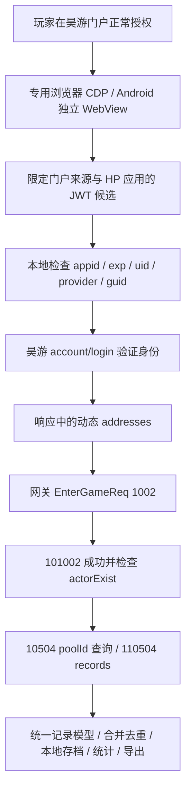

# Bilibili 渠道：历史进度与现有架构

> 历史研究归档（2026-10-23～24）。文内“尚未接入”“待验收”和测试版本号描述的是当时阶段，不代表当前发布状态。B 服与 TapTap App 入口已纳入 Android 0.3.6，真机 TapTap 授权修复已合入 `debug`；授权后仍需手动切回，通知返回方案未保留。当前流程以[渠道登录说明](../gacha-channel-login.md)、[用户指南](../gacha-user-guide.md)和源码为准。

核对日期：2026-10-23（北京时间）。本文件是正式研究交付物。脚本、哈希清单、定向提取内容和实验结果统一保存在 `E:/AI-Agent/OpenAI-Codex/bilibili-channel-research/`，不进入仓库。本文不含真实账号、凭据、密钥或第三方完整源码。

## 恢复来源及范围

先通过 Codex `read_thread` 读取了以下三个对话，再进行包体和业务代码分析。未逐条重放全部历史；以关键回合、现存交接材料和当前源码交叉核对。

| 对话 | 本次读到的进度 | 不能据此认定的事项 |
|---|---|---|
| `01a157e6-3d2a-73e1-9b04-3f62b0ba3c29`，抽卡记录查询工具 | 最新 8 回合及前一页 10 回合；Windows/Android v0.3.4、配置分发、存档、导出、QQ 授权回流和用户真机验收记录 | 当前检出目录等于发布工作树、B 服已受支持 |
| `01a0edea-e678-7a81-a922-a57045be1e72`，账号内数据爬取研究 | 最新 8 回合；官服动态网关、角色态握手、多类只读查询、抽卡记录已有真实成功证据 | 今天凭据有效、相同字段对 B 服必然有效 |
| `01a14043-abf5-7173-8f8e-82af9d2251fa`，登陆状态刷新研究 | 最新 8 回合；门户/PnSDK、生命周期、原版宿主续期和独立宿主限制 | 最后等待任务已成功、B 服可以照搬 PnSDK JWT |

进一步读取的已有材料（均位于 `E:/AI-Agent/OpenAI-Codex/starfall-status-research/`）：

- `combined-web-login-account-runbook-20261020.md`：10 月 20 日网页凭据携带的 GUID 已支持脱离 MuMu 查询；四入口 9/0/3/2 条、去重 14 条、131 抽。这是历史实测报告，本次没有重新执行线上请求。
- `login-refresh-handoff-20261020.md`：此前生命周期观察、DEX 解析错误、凭据同步及不能混淆的失败阶段。
- `independent-refresh-verified-20261020.md`：记录一次独立 HTTP 续签成功，但使用了缓存接入参数及包内签名常量。这里只恢复历史事实；本任务不复用、提取或实现该签名路线。
- 已有 DEX 解析器修正了 `invoke-virtual/invoke-super` 指令长度。本轮定向调用扫描复用修正后的宽度处理，不能沿用旧版错位调用结论。

当前 `E:/All-Projects/XL/docs/` 起初没有 `gacha-architecture.md` 和 `gacha-development.md`。已只读核对 `E:/AI-Agent/OpenAI-Codex/worktrees/XL-gacha-config-storage/docs/` 下同名文档；当前业务结论仍以本仓库实际文件为准。当前工作区已有大量修改，两个抽卡客户端在本检出的 Git 状态中为未跟踪目录；本轮未迁移、覆盖或提交这些内容。

## 官服当前真实调用链

本地 JWT 解码不验证签名；身份有效性最终由认证服务器决定。

| 问题 | 当前源码依据与结论 |
|---|---|
| 凭据来源 | `xl_gacha_web/portal_login.py:23` 起限定 `https://i.haoplay.com.cn`；候选 `jwt/lastjwt/HP_2070021/HP_2070023`。Android `LoginActivity.java:17` 起同类来源限制 |
| 凭据层次 | `gacha_core/gacha.py:38` 起解析平台应用 JWT；`uid → open_id`、`provider → 认证 channel`、`guid → device_id`。这里不是游戏角色 UIN，也不是任意 B 站站内 UID |
| 游戏认证 | `gacha.py:199` 的 `authenticate` 发送 `openId/token/platform=1/channel=provider/buildVersion=''/authRemote=true`。客户端没有实现服务端如何向渠道验证的逻辑，不能推断服务端私有实现 |
| 认证响应 | 检查 `retCode/maintainState`；从 `data.addresses` 选择符合白名单的 `*.haoplay.com.cn:8801`。现实现只把网关地址传下去，未从响应创建另一种令牌 |
| 进入角色态 | `gacha.py:236` 的 `enter_frame` 使用原令牌、设备 GUID、固定 `haoplay_cn`、平台 1、authRemote、openId；`fetch_history` 检查返回业务码和 actorExist |
| 历史查询 | `gacha.py:243` 起 `decode_records/merge_records/fetch_history`；进入角色态后只发送 poolId，未在历史消息里重新携带渠道账号 |
| 存档身份 | `archive.py:45` 的 `account_id` 使用 `SHA256(channel:uid)` 前 16 字节。`app.py:43` 起 `QueryService` 保存的是认证 openId/provider；并非从 ActorInfo 提取的游戏 UIN |
| Android 对应 | `GachaClient.java:17/26/29/59` 起分别是 JWT 解析、同算法账号键、认证、固定官服进入消息；`MainActivity.java:93` 保存登录 profile 与账号键 |

账号隔离目前以认证 provider + 外部 UID 为基础。若 B 服接入，应额外定义明确渠道命名空间与角色/区服映射，不能把 SDK 的 UID 或“同数字 UID”直接视为同一游戏角色。

## 证据等级

**历史实测确认（本轮恢复，非今天重测）**：官服门户 → 游戏认证 → 动态网关 → 游戏会话 → 抽卡查询成立；网页 GUID 已解除早期必须依赖 ADB 设备字段的限制。v0.3.4 相册、分享和切换账号存在用户验收记录。

**本轮静态确认**：官服入口、字段、白名单、存档算法和 B 服调用链见上表及差异报告；本轮八种消息结构对比、合成解析和 17 项既有测试通过。

**有证据支持的推断**：B 服认证会话取得后，可大幅复用查询、解析、统计和导出层。相同消息结构不能证明相同物理网关、角色命名空间或当前服务端行为。

**本轮后续真实验证**：用户在原版 B 服登录了新账号并进入教程。正常 SDK 回调的 access_token 是不透明令牌，与 PnSDK 缓存 JWT 不同。离线确认游戏渠道为 `bilibili`，并在用户明确授权后做一次独立认证，HTTP 200、retCode=0，返回 `elpis-gw.haoplay.com.cn:8801`；没有打开网关会话。

**18:45 最新独立路径实测**：验证器以真实包名调起官方 B 站并确认授权，配合当前账号官方公开资料中的 UID，原样使用返回的 App access_key 即可通过游戏认证。无效令牌对照被拒绝；用验证器随机 UUID 进入网关，101002 为 0、actorExist=true；10504 查询 selector=1，110504 为 0、记录为空。没有原版游戏运行、root、SDK 密钥或令牌交换依赖。此前仅 SDK 内部存在交换步骤，不能据此推断工具必须交换。

**20:21 最新自动路径实测**：在用户明确允许使用《星落》客户端接入配置复现 SDK 请求签名后，独立验证器通过官方 App 授权和 SDK 交换自动取得 UID/SDK access_key。20:19 和 20:21 两次用交换返回的 SDK 令牌认证、进入已有角色并查询 selector=1，均为成功空历史；SDK 令牌与 App grant 不同。取消后可重新授权；最后一次原版游戏进程前后均不存在。无需手填 UID、root 或游戏私有会话，配置值未进入仓库。

**2026-10-24 安卓手记接入验收**：独立测试包 `cn.starfall.gacha.bilitest` / `0.4.0-bili-test` 已复用完整手记。官方 B 站授权后自动交换 UID/SDK 令牌，认证及进入已有角色成功，选择器 `1、2、24000001、24000002` 均返回码 0、记录数 0。按渠道和 UID 隔离存档，更新/重启恢复成功；JSON 导出到下载/Starfall，实测 2964 字节且可解析，不含令牌字段。每次查询保留官方授权，提供无 UID/令牌的脱敏诊断。构建输入的真实客户端配置和产物均在 E 盘 Codex 专用工作区，仓库只有通用实现。

**当前限制**：真实非空历史、长期会话、身份切换和实体手机完整链路待验收；用户将用手机已有记录的 B 服账号测试。Windows 独立入口仍未接入。空历史与失败分开显示，当前 4 个卡池的回执可在页面查看。Android 10 及以上采用 MediaStore 保存导出；MuMu 原文档提供器曾拒绝写权限，Android 9 的文件选择器路径未完成验收。

**已证实不能直接沿用的做法**：把当前 JWT 解析器直接用于任意渠道 SDK 回调；把 `provider` 与网关固定 `haoplay_cn` 当成同一概念；把旧 ADB 依赖或“续签仍未成功”的早期状态当成最新官服结论。没有实测证明 B 服整体不可行。

## 继续研究入口

**合并后的渠道测试更新**：基于下述完整合并基线，现已接入 Android TapTap App 授权入口，`0.3.5-tap-test` / 403 可覆盖原 B 服测试包。既有 B 服入口保留，TapTap 包内成功查询 243 条记录、1746 抽；手机继续验收。见[接入记录](taptap-app-login.md)的“产品接入后续”。

**最新合并状态（2026-10-24）**：已按用户要求先整合 `5402df97` 的完整 0.3.4 客户端，再叠加既有 B 服实现。402 测试包已覆盖升级，两个账号及官服 243 条记录/1746 抽保留；旧状态清理、QQ 回流、相册/分享回归通过，B 服官方授权后四个卡池再次成功空历史。TapTap App 新入口尚未开发。当前基线与完整验收见[0.3.5 合并记录](../releases/gacha-v0.3.5.md)，以下基线核查更正属于合并前的历史原因。

**构建基线核查更正（2026-10-24）**：本轮从主目录较旧源码构建的 B 服研究包未继承完整已发布 0.3.4。旧凭据清理、QQ 分享回流、相册/分享等不能以该包的行为判断正式版状态。正式 0.3.4 的新登录清理与轮询门控仍存在于发布源码和 APK；不是修复失效。后续整合以 `E:\AI-Agent\OpenAI-Codex\worktrees\XL-gacha-config-storage` 的已验收 0.3.4 为基线，并保留其全部修复和功能。改变版本名称本身不构成基线升级。详见 [TapTap 研究与基线更正](taptap-app-login.md)。

先读 [包体与协议差异](bilibili-channel-diff.md)、[可行性与验证记录](bilibili-channel-feasibility.md) 和 [授权入口研究](bilibili-channel-authorization.md)。Android 已走通官方 App 授权、自动 SDK 身份交换和成功空历史，下一阶段围绕稳定交互、会话/渠道适配和正式客户端接入推进，并补验其他既有选择器与非空记录。手填 UID 留作备用。Windows 入口单独研究，不重复已完成的官服恢复与包体分析。
